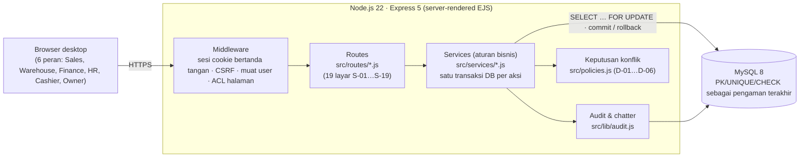
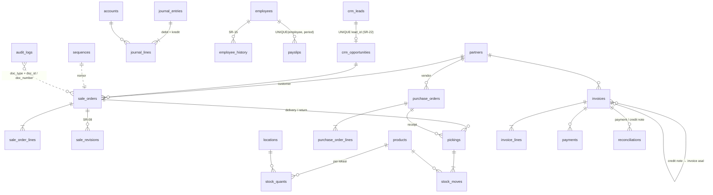
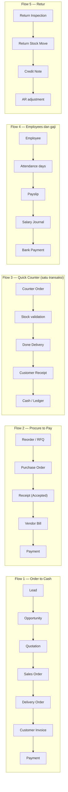

# Arsitektur & Model Data

## 1. Arsitektur aplikasi



Prinsip yang dipakai:

1. **Aturan bisnis hanya di server.** Tampilan boleh menyembunyikan tombol, tetapi setiap aksi diperiksa ulang di layanan (`requirePerm`, validasi SR-xx). Uji T-30 dan T-38 sengaja mengirim permintaan langsung untuk membuktikannya.
2. **Satu aksi = satu transaksi database.** `src/lib/action.js` membungkus aksi dalam transaksi; bila ditolak, semua perubahan di-rollback lalu upaya tersebut tetap ditulis ke `audit_logs` (result `rejected` / `denied`). Deadlock antar transaksi bersamaan diulang otomatis maksimal 3 kali.
3. **Database sebagai pagar terakhir.** Contoh: `chk_quant_available` (reserved ≤ on hand), `chk_sol_invoiced`, `chk_pol_billed`, `chk_inv_residual`, `chk_je_balanced`, `uq_je_event` (satu jurnal per kejadian), `uq_opp_lead` (satu opportunity per lead), `uq_payslip_period`. Error constraint diterjemahkan menjadi pesan SR yang dapat dibaca.
4. **Penguncian baris (row lock)** pada quant stok, sequence nomor, dokumen, dan baris pesanan mencegah balapan (diuji di `test/robustness.test.js`).

## 2. Struktur folder

```
src/
  app.js, server.js, config.js, db.js, seed.js, schema.sql, policies.js
  lib/       acl (matriks hak), action (transaksi+audit), audit, errors, money (PBJT), sequence, listview, apps, ui, time
  services/  contacts, products, crm, sales, stock, purchase, invoicing, accounting, exposure,
             employees, payroll, counter, dashboard, auditsvc, reorder (F-23), auth
  routes/    satu file per modul (+ _chatter.js untuk panel ⑤)
views/       partials (top, control_panel, list, kanban, statusbar, smart, chatter, lines_editor) + pages
public/      css/app.css, js/app.js (line editor & pratinjau total; server tetap menghitung ulang)
test/        scenarios.test.js (T-01…T-38 di lapisan layanan), robustness.test.js (race, regresi, F-23)
e2e/         evidence.js (T-01…T-38 lewat UI + screenshot), lib.js
docs/        dokumen penyerahan
```

## 3. Model data (ERD ringkas)



Tabel utama dan isinya:

| Tabel | Isi | Kontrol penting |
|---|---|---|
| `products` | Variant SKU (produk, ukuran, warna, satuan, harga, standard cost) | UNIQUE sku, UNIQUE (name, size, color, uom) — SR-21 |
| `stock_quants` | On hand & reserved per SKU per lokasi | CHECK reserved ≤ on hand — SR-04 |
| `stock_moves` | Mutasi stok (opening, delivery, receipt, transfer, return, QC reject) | received = accepted + rejected — SR-19 |
| `sale_order_lines` | qty, delivered, returned, invoiced, credited, cancelled | invoiced ≤ delivered — SR-02 |
| `purchase_order_lines` | qty, accepted (qty_received), rejected, billed | billed ≤ accepted — SR-06 |
| `journal_entries` / `journal_lines` | Jurnal berpasangan | debit = kredit; `event_key` unik — SR-12 |
| `invoices` | Customer Invoice, Credit Note, Vendor Bill | residual 0…total — SR-20 |
| `payslips` | Simulasi gaji per karyawan per periode | UNIQUE (employee, period) — SR-12/17 |
| `audit_logs` | actor, time, action, document, result, detail | termasuk upaya yang ditolak — SR-13 |
| `messages` | Log notes / chatter per dokumen | — |

## 4. Alur dan efek lintas modul



| Kejadian | Efek stok | Jurnal (Dr / Cr) | Aturan |
|---|---|---|---|
| Opening balance | 773 unit (opening moves) | Dr 101 10.000.000, 102 25.000.000, 110 3.300.000, 120 5.422.000 / Cr 201 1.500.000, 301 42.222.000 | bukan transaksi tes, bukan pendapatan |
| SO Confirm | Reserved +qty (Available berkurang) | — | SR-04, SR-07, SR-09 |
| Delivery Done | On hand −done, reserved −done; sisa → backorder | Dr 501 COGS / Cr 120 (standard cost) | SR-02, SR-04 |
| Customer Invoice Post | — | Dr 110 total / Cr 401 subtotal, Cr 202 PBJT | SR-01/02, SR-12 |
| Customer Payment | — | Dr 102/101 / Cr 110 | SR-20 |
| Receipt Done (accepted) | WH-PKU +accepted; rejected → QC-REJECT | Dr 120 (std) / Cr 125 GRNI (harga PO), selisih → 701 | SR-19 |
| Vendor Bill Post | — | Dr 125 / Cr 201 | SR-05/06 |
| Vendor Payment | — | Dr 201 / Cr 102 | SR-20 |
| Internal Transfer Done | Asal −q, tujuan +q | — (nilai perusahaan tetap) | SR-11 |
| Return Done | Lokasi asal +layak jual | Dr 120 (layak jual) + Dr 602 (rusak) / Cr 501 | SR-10 |
| Credit Note Post | — | Dr 402 subtotal + Dr 202 PBJT / Cr 110 | SR-10 |
| Payslip Post | — | Dr 601 / Cr 203 | SR-16/17, SR-12 |
| Payslip Paid | — | Dr 203 / Cr 102 | SR-12 |
| Quick Counter | Outlet −qty | COGS + Invoice + Cash dalam satu transaksi | SR-14, SR-04 |

## 5. Struktur tampilan (Odoo Web 17)

Setiap layar mengikuti wireframe: **①** judul + Search · Filters · Group By, **②** view switcher (List | Kanban) atau statusbar, **③** main record & secondary fields, **④** baris/Kanban/KPI, **⑤** Related Docs · Log Notes · Audit / History. Menu kiri: *Overview · Orders / Documents · Reporting · Configuration*.

| Layar | URL |
|---|---|
| S-01 Beranda & app switcher | `/` |
| S-02 Kontak | `/contacts`, `/contacts/:id` |
| S-03 Katalog produk varian | `/products`, `/products/:id` |
| S-04 CRM pipeline | `/crm`, `/crm/leads/:id`, `/crm/opportunities/:id` |
| S-05 Quotation & Sales Order | `/sales/orders`, `/sales/orders/:id` |
| S-06 Delivery Order & backorder | `/inventory/pickings?type=out` |
| S-07 Stok & internal transfer | `/inventory/stock`, `/inventory/transfers/new` |
| S-08 RFQ & Purchase Order | `/purchase/orders` |
| S-09 Receipt & penerimaan mutu | `/inventory/pickings?type=in` |
| S-10 Customer Invoice | `/invoicing/invoices` |
| S-11 Vendor Bill | `/accounting/bills` |
| S-12 Register Payment | form di invoice/bill, daftar `/accounting/payments` |
| S-13 Journal Entries & General Ledger | `/accounting/entries`, `/accounting/ledger`, `/accounting/trial-balance` |
| S-14 Return & Credit Note | `/inventory/pickings?type=ret`, `/invoicing/credit-notes` |
| S-15 Employees | `/employees` |
| S-16 Payroll simulation | `/payroll` |
| S-17 Dashboard | `/dashboard` |
| S-18 Quick Counter Order | `/counter` |
| S-19 Audit & related documents | `/audit`, `/audit/trace?number=S00008` |
